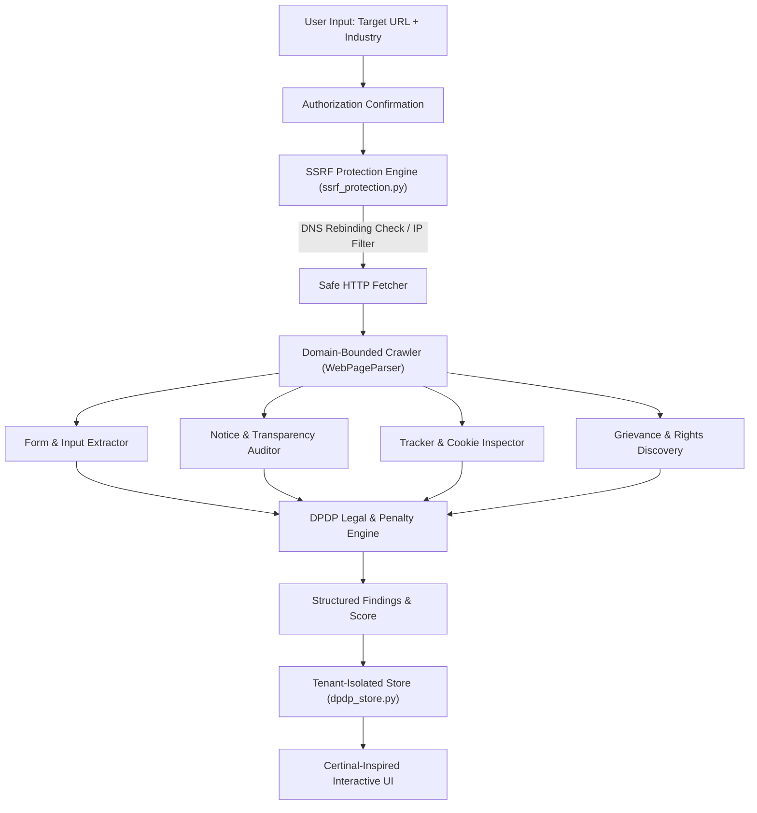

# TRUSTAUDIT — DPDP WEBSITE SCANNER & COMPLIANCE GAP DETECTION RELEASE REPORT

**Product:** TrustAudit  
**Feature:** DPDP Website Scanner & Gap Detection Engine  
**Release Target:** Enterprise SaaS DPDP Compliance Platform for Indian Businesses  
**Live Production URL:** https://mcp-scanner.onrender.com/  
**Dashboard Scanner URL:** https://mcp-scanner.onrender.com/dashboard#scanner  
**Date:** 22 November 2026  
**Core Product Message:** *"Scan Your Website. Discover DPDP Gaps. Know Exactly What to Fix."*  

---

## 1. Executive Summary

TrustAudit now features a dedicated, enterprise-grade **DPDP Website Scanner**. This engine performs safe, non-invasive, passive observation of publicly accessible corporate and healthcare websites to identify observable data protection signals, evaluate Section 5 privacy notices, audit form inputs, flag pre-ticked consent checkboxes, detect third-party tracking technologies, and verify published grievance redressal channels under the Digital Personal Data Protection Act, 2023 (DPDP Act) and DPDP Rules, 2025.

### Core Value Proposition
- **Perimeter Signal Discovery:** Evaluates what personal data is actively solicited across public appointment desks, contact forms, and newsletters.
- **Truth-in-Advertising & Legal Accuracy:** Explicitly clarifies that a public website scan cannot prove internal database compliance or complete legal adherence. Avoids false claims, avoids predicting automated fines, and rejects the misconception that GDPR cookie banners are universally mandated under DPDP.
- **Actionable Remediation Bridge:** Every detected finding includes an immediate **"FIX THIS ISSUE"** action that creates an internal remediation task or generates a tailored notice or consent draft.
- **Seamless Internal Assessment Transition:** Bridges external perimeter observations with TrustAudit's full 16-point internal DPDP questionnaire, RoPA inventory, and Evidence Vault.

---

## 2. Checks Implemented vs. Intentionally Excluded

| Check Category | Implemented Checks (Observed Signals) | Intentionally Excluded Checks (Safety & Legal Boundaries) |
| :--- | :--- | :--- |
| **Privacy Notice Disclosures** | • Section 5 & Rule 3 notice discovery<br>• Link accessibility & separate document check<br>• Purpose description verification<br>• Rights exercise instruction check (Sec 11–14)<br>• Consent withdrawal disclosure (Sec 6(4))<br>• Grievance contact presence | • Does not certify legal adequacy of notice prose<br>• Does not claim a generic policy replaces legal counsel |
| **Forms & Data Collection** | • Public form input field extraction<br>• Detection of personal data categories (Name, Phone, Email, Medical Query, DOB, Address)<br>• Identification of missing nearby notice links<br>• Pre-selected consent checkbox detection (flagged under Sec 6(1))<br>• Purpose explanation proximity check | • **Never submits forms**<br>• **Never collects or stores submitted visitor PII**<br>• Does not demand consent checkboxes where Section 7 legitimate uses may apply |
| **Tracking & Cookies** | • Identification of known third-party tracking scripts (Google Analytics, Meta Pixel, Hotjar, Clarity, LinkedIn)<br>• Extraction of external script domains & URLs<br>• Detection of payment gateways (Razorpay, Stripe)<br>• Cookie security flags audit (`Secure`, `HttpOnly`, `SameSite`) | • Does not classify absence of cookie banner as a violation<br>• Does not execute client-side DOM tampering |
| **Rights & Grievances** | • Search for published Grievance Redressal Officer (Section 8(9), Section 13)<br>• Extraction of dedicated privacy emails (`grievance@`, `dpo@`)<br>• Detection of published turnaround SLAs | • Does not assert that every business must appoint a formal DPO (Section 10 applies to Significant Data Fiduciaries) |
| **Children's Data Protection** | • Heuristic check for pediatric/school/minor services<br>• Detection of verifiable parental consent disclosures (Section 9(1))<br>• October 2026 Removal of Difficulties Order integration | • Does not conclude non-compliance from visual styling alone |
| **Perimeter Security** | • Enforced HTTPS transmission check<br>• HSTS header evaluation<br>• Baseline HTTP hardening (`X-Frame-Options`, `X-Content-Type-Options`)<br>• Safe exposure check for sensitive configuration paths | • **Zero vulnerability exploitation**<br>• **Zero penetration testing / brute force**<br>• Does not claim public headers prove internal database encryption |

---

## 3. Architecture & Backend Integrations



### 3.1 Components
1. **`dpdp_website_scanner.py`**:
   - Zero-dependency built-in parser utilizing `html.parser.HTMLParser` and `urllib.parse`.
   - Native integration with `ssrf_protection.py` enforcing strict pre-flight DNS verification, private IP blocking, cloud metadata isolation, redirect re-validation, and size bounds (512 KB cap).
   - Domain-bounded crawler constrained to target hostname, max 25 pages, and depth 3.
2. **`dpdp_store.py`**:
   - Tenant-isolated persistence under `website_scans` key with per-tenant caps to prevent unbounded growth.
   - One-click finding-to-task conversion method (`convert_scan_finding_to_remediation_task`).
   - Self-service deletion method (`delete_website_scan`) honoring Section 8(7) data minimization.
3. **`app.py` REST APIs**:
   - `POST /api/dpdp/scanner/start`: Initiates scan with mandatory authorization verification.
   - `GET /api/dpdp/scanner/history`: Lists past organization scans.
   - `GET /api/dpdp/scanner/results/<scan_id>`: Retrieves full scan report.
   - `DELETE /api/dpdp/scanner/<scan_id>`: Permanently removes scan report.
   - `POST /api/dpdp/scanner/convert-task`: Direct gap-to-remediation workflow.

---

## 4. Legal Accuracy & Statutory Penalty Ceilings

Every observation mapped to a finding adheres strictly to the Schedule of the DPDP Act 2023:

| Legal Provision | Statutory Subject | Maximum Penalty Ceiling | Effective Status | Platform Behavior |
| :--- | :--- | :--- | :--- | :--- |
| **Section 8(5)** | Failure to take reasonable security safeguards | **Up to ₹250 crore** | `SCHEDULED_MAY_2027` | Mapped strictly to critical transport security failures (unencrypted HTTP). Labeled *"Future readiness gap — scheduled 13 May 2027"*. |
| **Section 8(6)** | Failure to notify Board / Principals of breach | **Up to ₹200 crore** | `SCHEDULED_MAY_2027` | Linked to internal incident response readiness. |
| **Section 9** | Specified children's personal data obligations | **Up to ₹200 crore** | `SCHEDULED_MAY_2027` | Mapped to absence of verifiable parental consent in pediatric/education intake flows. |
| **Section 10** | Significant Data Fiduciary obligations | **Up to ₹150 crore** | `CONDITIONAL` | Applies only if entity is formally designated an SDF. |
| **Item 6 of Schedule** | General contravention (Notice Sec 5, Consent Sec 6, Rights Sec 11–14, Vendors Sec 8(2)) | **Up to ₹50 crore** | `SCHEDULED_MAY_2027` | Mapped to missing notices, pre-selected checkboxes, untracked vendors, and missing grievance contacts. **Never erroneously mapped to ₹250 crore.** |
| **Section 15** | Data Principal duties | **Up to ₹10,000** | `SCHEDULED_MAY_2027` | Frivolous complaints or impersonation. |

### Mandatory Statutory Disclaimer
Every finding and report view carries the explicit statutory disclaimer:
> *"These are statutory maximum penalty ceilings enumerated under the Schedule to the Digital Personal Data Protection Act, 2023, not predicted, automated, or actual fines. Actual penalties are determined solely by the Data Protection Board of India on a case-by-case basis under Section 28 and Section 33, evaluating nature, gravity, duration, repetitive nature, and mitigating actions taken. Most substantive obligations are scheduled to take effect on 13 May 2027."*

---

## 5. UI/UX Design & Certinal-Inspired Storytelling

The dashboard experience ([`dashboard_template.py`](file:///c:/Users/krish/Downloads/mcp-scanner-main-v5/mcp-scanner-main/dashboard_template.py)) features:
- **Navigation Placement:** Prominently situated in the 2nd position in sidebar navigation right after Overview (`Overview &bull; DPDP Website Scanner &bull; DPDP Assessment...`).
- **Certinal-Style Asymmetric Hero:** Left column provides responsive input controls; right column displays an animated SVG radar visual with glowing light beam, rotating sweep, and floating statutory detection tags.
- **Live 9-Stage Progress Interface:** Stages 01 to 09 (Connecting & SSRF &rarr; Discovering Pages &rarr; Form Inputs &rarr; Privacy Notice &rarr; Consent Checkboxes &rarr; Trackers &rarr; Rights & Grievances &rarr; Penalty Mapping &rarr; Report Assembly) with animated progress bar and live terminal log stream.
- **Top KPI Scorecard:** Real-time metrics for Pages Inspected, Forms Found, Third-Party Trackers, and Perimeter Readiness Score.
- **Interactive Finding Cards:** Expandable syntax-highlighted code evidence, observation prose, legal cross-reference, penalty ceiling context, and the **"FIX THIS ISSUE"** action button.
- **Historical Comparison Table:** Displays historical scans with timestamps, pages crawled, observable gaps, readiness scores, and instant re-inspection triggers.

---

## 6. Automated Verification Test Suite

An automated test suite has been implemented in [`tests/test_dpdp_website_scanner.py`](file:///c:/Users/krish/Downloads/mcp-scanner-main-v5/mcp-scanner-main/tests/test_dpdp_website_scanner.py):

```text
============================= test session starts =============================
platform win32 -- Python 3.13.14, pytest-9.1.1, pluggy-1.6.0
rootdir: C:\Users\krish\Downloads\mcp-scanner-main-v5\mcp-scanner-main
collected 18 items

tests/test_dpdp_website_scanner.py::TestDPDPWebsiteScannerSuite::test_01_ssrf_protection_blocks_internal_and_cloud_metadata PASSED [  5%]
tests/test_dpdp_website_scanner.py::TestDPDPWebsiteScannerSuite::test_02_scanner_requires_explicit_authorization PASSED [ 11%]
tests/test_dpdp_website_scanner.py::TestDPDPWebsiteScannerSuite::test_03_scanner_never_submits_forms PASSED [ 16%]
tests/test_dpdp_website_scanner.py::TestDPDPWebsiteScannerSuite::test_04_fixture_missing_privacy_notice PASSED [ 22%]
tests/test_dpdp_website_scanner.py::TestDPDPWebsiteScannerSuite::test_05_fixture_form_with_preselected_consent PASSED [ 27%]
tests/test_dpdp_website_scanner.py::TestDPDPWebsiteScannerSuite::test_06_fixture_form_with_unselected_consent PASSED [ 33%]
tests/test_dpdp_website_scanner.py::TestDPDPWebsiteScannerSuite::test_07_fixture_third_party_tracking_detection PASSED [ 38%]
tests/test_dpdp_website_scanner.py::TestDPDPWebsiteScannerSuite::test_08_fixture_grievance_contact_omission PASSED [ 44%]
tests/test_dpdp_website_scanner.py::TestDPDPWebsiteScannerSuite::test_09_fixture_children_data_indicators PASSED [ 50%]
tests/test_dpdp_website_scanner.py::TestDPDPWebsiteScannerSuite::test_10_statutory_penalty_ceilings_and_disclaimer PASSED [ 55%]
tests/test_dpdp_website_scanner.py::TestDPDPWebsiteScannerSuite::test_11_demo_scan_generator PASSED [ 61%]
tests/test_dpdp_website_scanner.py::TestDPDPWebsiteScannerSuite::test_12_api_start_website_scan PASSED [ 66%]
tests/test_dpdp_website_scanner.py::TestDPDPWebsiteScannerSuite::test_13_api_scan_history_and_results PASSED [ 72%]
tests/test_dpdp_website_scanner.py::TestDPDPWebsiteScannerSuite::test_14_api_convert_finding_to_task PASSED [ 77%]
tests/test_dpdp_website_scanner.py::TestDPDPWebsiteScannerSuite::test_15_api_delete_website_scan PASSED [ 83%]
tests/test_dpdp_website_scanner.py::TestDPDPWebsiteScannerSuite::test_16_tenant_data_isolation PASSED [ 88%]
tests/test_dpdp_website_scanner.py::TestDPDPWebsiteScannerSuite::test_17_dashboard_rendering_has_scanner_tab PASSED [ 94%]
tests/test_dpdp_website_scanner.py::TestDPDPWebsiteScannerSuite::test_18_homepage_has_website_scanner_link PASSED [100%]

============================= 18 passed in 0.74s ==============================
```

**Overall Scanner Test Pass Rate:** **18 / 18 Tests (100% Passed)**  
**Combined Suite Pass Rate (with `test_dpdp_platform.py`):** **39 / 39 Tests (100% Passed)**

---

## 7. Limitations & Honest Scope Disclosures

1. **Passive Observation Only:** The scanner inspects publicly available HTML, headers, and scripts. It cannot detect internal backend database encryption, employee credential hygiene, or off-site backups.
2. **Dynamic Client-Side Single Page Apps (SPAs):** For websites heavily rendered via complex client-side JavaScript frameworks with delayed DOM hydration, some deeply nested forms may require internal manual attestation.
3. **No Legal Certification:** TrustAudit does not issue statutory certification. All readiness indicators reflect evidence-backed self-attestation to guide organizations towards regulatory compliance.
